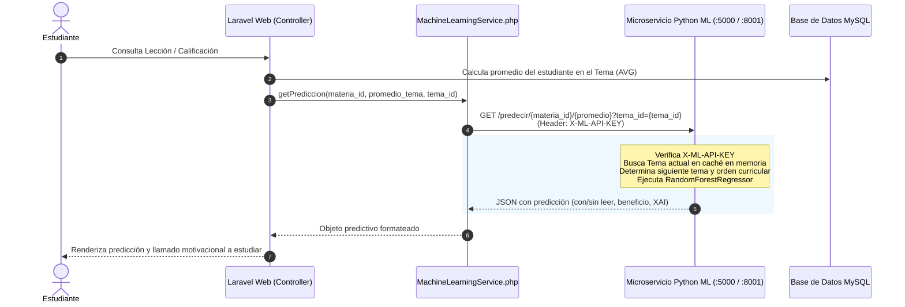
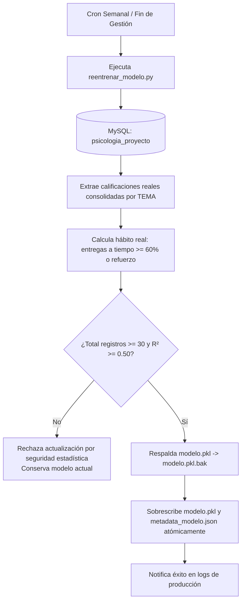

# Microservicio de Machine Learning — Predicción del Rendimiento Académico y Recomendación Curricular

### Plataforma Académica Preuniversitaria — Carrera de Psicología (UPEA)

Microservicio analítico, predictivo y prescriptivo desarrollado en **Python (Flask, Scikit-Learn, Gunicorn)** que modela el rendimiento académico de los postulantes universitarios a nivel de **Tema Curricular**. Proporciona proyecciones de calificación futura con/sin lectura anticipada, sugerencias pedagógicas basadas en el texto guía de la carrera y semáforos de alerta temprana de riesgo académico bajo estándares **ISO/IEC 27001** (seguridad) e **ISO/IEC 25010** (calidad y latencia).

---

## 1. Fundamentos Metodológicos (CRISP-DM y Eje Temático)

El modelo predictivo fue diseñado bajo la metodología **CRISP-DM** (*Cross-Industry Standard Process for Data Mining*), sustentado en las siguientes definiciones pedagógicas y de ingeniería de datos:

1. **Unidad Invariante de Análisis — El TEMA (`temas`):**
   - En el proceso formativo, las **lecciones o tareas** varían año tras año según el criterio del docente titular (un docente puede asignar 2 tareas para un tema en 2026, y otro docente 4 tareas en 2027).
   - Por esta razón, el modelo **no entrena ni predice por número de lección o tarea**. El eje curricular estable entre gestiones (2026 $\to$ 2027 $\to$ 2028) es la tabla `temas` (`materia_id`, `orden`, `paginas_libro`).
2. **Exclusión de la tabla `libros`:**
   - La tabla `libros` se reserva de forma exclusiva para el carrusel y visor PDF público de la landing page institucional. No interviene en el pipeline de entrenamiento ni en la analítica predictiva.
3. **Inferencia del Hábito Real de Estudio:**
   - Al no existir telemetría intrusiva de clics sobre PDFs, el hábito de estudio se aproxima mediante variables conductuales verificables:
     - Entrega puntual de tareas asignadas ($\ge 60\%$).
     - Realización y completitud de cuestionarios de refuerzo adaptativo.

---

## 2. Algoritmo y Métricas del Modelo

| Parámetro / Métrica | Especificación Técnica |
| :--- | :--- |
| **Algoritmo** | `RandomForestRegressor(n_estimators=100, random_state=42)` |
| **Pipeline de Características** | `ColumnTransformer` + `OneHotEncoder(handle_unknown='ignore')` para `materia_id` |
| **Variables de Entrada (Features)** | `['materia_id', 'tema_orden', 'nota_previa', 'leyo_material']` |
| **Variable Objetivo (Target)** | `mejora` (diferencia de nota hacia el siguiente tema) |
| **Validación Cruzada / Partición** | 80% Entrenamiento (Train) / 20% Prueba (Test) con semilla fija |
| **Error Absoluto Medio (MAE)** | **2.67 puntos** en escala centesimal |
| **Coeficiente de Determinación ($R^2$)** | **0.8781** (87.8% de varianza explicada) |

### Explicabilidad del Modelo (XAI — Explainable AI)
Para mitigar el problema de "caja negra" ante comités académicos y revisores de tesis, el modelo exporta los pesos de importancia de variables (`feature_importances_`):

| Característica | Peso XAI | Interpretación Pedagógica |
| :--- | :--- | :--- |
| `peso_repaso_tema` | **51.22%** | El factor determinante en la mejora es el estudio anticipado del material temático. |
| `peso_nota_previa` | **44.54%** | Refleja el conocimiento acumulado y base conceptual del postulante. |
| `peso_orden_tema` | **3.18%** | Modela el incremento gradual de complejidad a lo largo del temario. |
| `peso_materia` | **1.05%** | Ajuste específico según la materia de psicología evaluada. |

---

## 3. Cumplimiento de Estándares Internacionales

- **ISO/IEC 27001 (Seguridad de la Información):**
  - Autenticación obligatoria mediante la cabecera HTTP `X-ML-API-KEY`.
  - Sin credenciales quemadas en código fuente; configuración centralizada en [.env](file:///.env).
  - Consultas SQL a base de datos MySQL 100% parametrizadas (`%s`) para evitar inyección SQL.
  - Bind local restringido `127.0.0.1` (no expuesto a la red pública sin proxy/firewall).
  - Privacidad de datos: la API procesa agregaciones estadísticas (`AVG(nota)` por tema) sin exponer datos personales del estudiante.
- **ISO/IEC 25010 (Eficiencia y Calidad del Software):**
  - **Latencia ultra baja:** Catálogo de materias y temas en memoria con TTL de 30 minutos (tiempo de respuesta $\approx \mathbf{10.2\text{ ms}}$).
  - **Tolerancia a fallos:** Respuesta de contingencia (*cold start*) cuando una materia o tema nuevo no tiene histórico suficiente.
  - **Logging rotativo:** Registro de eventos en `ml_service.log` con rotación automática (máximo 5 MB por archivo, 3 respaldos).

---

## 4. Estructura del Proyecto

```text
machine_learning/
├── api_ml.py                # API REST en Flask con seguridad, caché XAI y catálogo
├── entrenar_modelo.py       # Pipeline Scikit-Learn: entrenamiento, métricas y exportación
├── generador_datos.py       # Generador sintético v6 a nivel de Tema (500 registros)
├── reentrenar_modelo.py     # Reentrenamiento acumulativo multigestión con reemplazo atómico
├── test_api.py              # Suite automatizada de pruebas de caja blanca y caja negra
├── supervisor_ml.conf       # Configuración para el demonio Supervisor en Ubuntu VPS
├── requirements.txt         # Dependencias Python fijadas
├── metadata_modelo.json     # Metadatos del modelo: versión, MAE, R², pesos XAI
├── modelo.pkl               # Cerebro del modelo serializado con joblib
├── datos_sinteticos.csv     # Dataset base generado para inicialización
├── .env.example             # Plantilla de variables de entorno
└── .gitignore               # Exclusión de venv, .env y logs
```

---

## 5. Flujos de Trabajo (Mermaid)

### A. Inferencia Predictiva en Tiempo Real (Laravel $\leftrightarrow$ Python ML)



### B. Ciclo de Reentrenamiento Continuo y Aprendizaje Acumulativo



---

## 6. Especificación de Endpoints de la API REST

Todos los endpoints requieren la cabecera HTTP:
```http
X-ML-API-KEY: ml_secret_token_2026_psi_upea
```

### 1. Diagnóstico de Salud y Metadatos CRISP-DM
* **Método:** `GET`
* **Ruta:** `/salud`
* **Respuesta Exitosa (HTTP 200):**
```json
{
  "estado": "operativo",
  "version": "2.0.0",
  "modelo_cargado": true,
  "metadatos": {
    "algoritmo": "RandomForestRegressor(n_estimators=100, random_state=42)",
    "mae": 2.67,
    "r2": 0.8781,
    "feature_importances": {
      "peso_nota_previa": 0.4454,
      "peso_repaso_tema": 0.5122,
      "peso_orden_tema": 0.0318,
      "peso_materia": 0.0105
    }
  },
  "catalogo_en_memoria": {
    "total_temas": 12,
    "total_materias": 2
  }
}
```

---

### 2. Predicción de Rendimiento del Próximo Tema
* **Método:** `GET`
* **Ruta:** `/predecir/<int:materia_id>/<float:nota_actual>?tema_id=<int>`
* **Respuesta Exitosa (HTTP 200):**
```json
{
  "tiene_datos_historicos": true,
  "materia_id": 1,
  "materia_nombre": "INTRODUCCIÓN A LA PSICOLOGÍA",
  "nota_previa": 65.0,
  "tema_actual": {
    "id": 1,
    "nombre": "Tema 1: Qué es la Psicología",
    "orden": 1
  },
  "siguiente_tema": {
    "id": 2,
    "nombre": "Tema 2: Bases Biológicas de la Conducta",
    "orden": 2,
    "paginas_libro": "págs. 14-28"
  },
  "prediccion_sin_leer": 68.4,
  "prediccion_con_leer": 91.2,
  "beneficio": 22.8,
  "mensaje": "Si no te preparas: ~68.4/100 | Si estudias el material: ~91.2/100 (+22.8 pts)",
  "xai_factores": {
    "repaso_tema": 0.5122,
    "nota_previa": 0.4454,
    "orden_tema": 0.0318,
    "materia": 0.0105
  }
}
```

---

### 3. Recomendación Curricular y Lectura Preventiva
* **Método:** `GET`
* **Ruta:** `/recomendar/<int:materia_id>/<float:nota_inicial>?tema_id=<int>`
* **Respuesta Exitosa (HTTP 200):**
```json
{
  "tiene_datos_historicos": true,
  "materia_id": 1,
  "materia_nombre": "INTRODUCCIÓN A LA PSICOLOGÍA",
  "recomendacion": "Estudia con anticipación el tema 'Tema 2: Bases Biológicas de la Conducta' (págs. 14-28). Según el modelo analítico, repasar previamente incrementa tu rendimiento proyectado en +22.8 puntos.",
  "siguiente_tema": {
    "id": 2,
    "nombre": "Tema 2: Bases Biológicas de la Conducta",
    "orden": 2,
    "paginas_libro": "págs. 14-28"
  },
  "beneficio_estimado": 22.8
}
```

---

### 4. Alerta Temprana de Riesgo Académico (Docentes y Tutores)
* **Método:** `GET`
* **Ruta:** `/riesgo/estudiante/<int:estudiante_id>/<int:materia_id>`
* **Respuesta Exitosa (HTTP 200):**
```json
{
  "estudiante_id": 14,
  "materia_id": 1,
  "promedio_acumulado": 54.0,
  "temas_evaluados": 2,
  "nivel_riesgo": "MEDIO",
  "color_alerta": "amarillo",
  "diagnostico": "El estudiante presenta un rendimiento limítrofe (54.0/100). Requiere seguimiento en el próximo tema para prevenir deserción.",
  "proyeccion_siguiente_tema": 72.5
}
```

---

## 7. Instalación y Puesta en Marcha (Servidor VPS Linux / Ubuntu)

### Paso 1: Clonar o Copiar el Repositorio
```bash
cd /var/www
git clone https://github.com/Mirianfl/machine_learning.git
cd /var/www/machine_learning
```

### Paso 2: Crear el Entorno Virtual de Python e Instalar Dependencias
```bash
# Instalar python3-venv si no estuviera disponible
sudo apt update && sudo apt install -y python3-venv python3-pip

# Crear entorno virtual aislado
python3 -m venv venv

# Activar e instalar librerías
source venv/bin/activate
pip install --upgrade pip
pip install -r requirements.txt
```

### Paso 3: Configurar Variables de Entorno (`.env`)
Copia la plantilla y edita las credenciales de MySQL y clave secreta:
```bash
cp .env.example .env
nano .env
```
Contenido recomendado de `.env`:
```ini
DB_HOST=127.0.0.1
DB_PORT=3306
DB_USER=root
DB_PASSWORD=tu_password_seguro
DB_NAME=psicologia_proyecto

ML_HOST=127.0.0.1
ML_PORT=8001
ML_API_KEY=ml_secret_token_2026_psi_upea
```

### Paso 4: Entrenar el Modelo Inicial (si no existe `modelo.pkl`)
```bash
python generador_datos.py
python entrenar_modelo.py
```

### Paso 5: Ejecutar la Suite de Pruebas
```bash
python test_api.py
```
Debe indicar: `🎉 TODAS LAS PRUEBAS (10/10) PASARON EXITOSAMENTE`.

---

## 8. Despliegue en Producción con Supervisor y Gunicorn

Para garantizar alta disponibilidad (reinicio automático ante fallos o reinicio del VPS), se utiliza **Supervisor** con **Gunicorn**.

### Paso 1: Copiar la Configuración de Supervisor
```bash
sudo cp supervisor_ml.conf /etc/supervisor/conf.d/ml_service.conf
```

### Paso 2: Ajustar Rutas y Permisos en `/etc/supervisor/conf.d/ml_service.conf`
Asegúrate de que coincida con tu usuario del sistema (ej. `vps-comp` o `www-data`) y el puerto deseado (`:8001` o `:5000`):
```ini
[program:ml_service]
directory=/var/www/machine_learning
command=/var/www/machine_learning/venv/bin/gunicorn -w 2 -b 127.0.0.1:8001 api_ml:app --access-logfile - --error-logfile -
user=vps-comp
autostart=true
autorestart=true
stopasgroup=true
killasgroup=true
stderr_logfile=/var/log/ml_service.err.log
stdout_logfile=/var/log/ml_service.out.log
environment=PATH="/var/www/machine_learning/venv/bin"
```

### Paso 3: Iniciar y Supervisar el Servicio
```bash
sudo supervisorctl reread
sudo supervisorctl update
sudo supervisorctl status ml_service
```

Respuesta esperada:
```text
ml_service                       RUNNING   pid 14238, uptime 12:34:56
```

---

## 9. Integración con Laravel (`.env` del Proyecto Principal)

En el archivo `.env` de la plataforma web en Laravel (`/var/www/proyecto_psicologica_v2/.env`):
```ini
ML_SERVICE_URL=http://127.0.0.1:8001
ML_API_KEY=ml_secret_token_2026_psi_upea
```
Y ejecuta en Laravel para consolidar la configuración:
```bash
php artisan optimize
```

---

## 10. Licencia y Créditos
* **Institución:** Universidad Pública de El Alto (UPEA) — Carrera de Psicología.
* **Proyecto:** Plataforma Académica Preuniversitaria y Asistente Pedagógico Inteligente.
* **Versión del Microservicio:** 2.0.0 (Producción).
